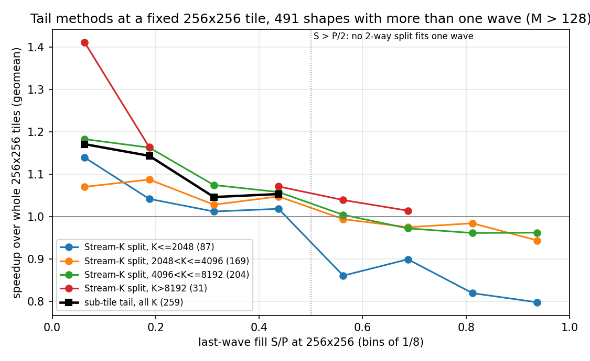
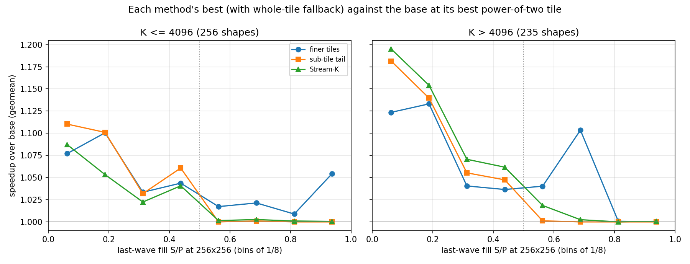
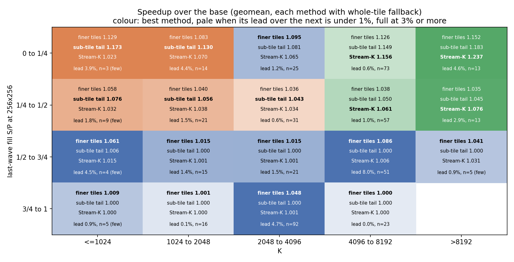
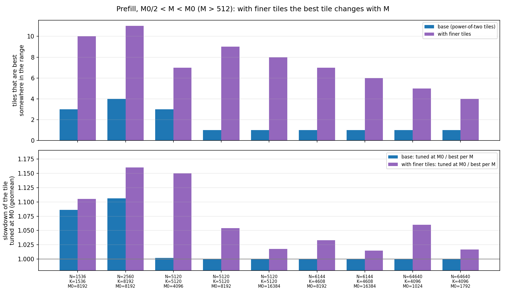

# Wave quantization on MI355X with more than one wave: Stream-K, sub-tile tails or finer tiles

## The problem

A GEMM is split into output tiles, and each of the P = 256 CUs runs one tile at a time, so
the tiles run in waves of 256. When the largest tile, 256x256, gives more than one wave
and the last wave is only partly full, the GEMM pays for wave quantization: S tiles are
left over after the full waves, and P - S CUs sit idle while they run. This mostly affects
compute-bound GEMMs, since they are the ones large enough to need more than one wave of
the largest tile.

PR [#7391](https://github.com/ROCm/aiter/pull/7391) (gfx950 gluon Stream-K) measures the
cost in its wave-quantization figure (K = 4096): 16 tiles past a full wave, which leaves
240 CUs idle in the last wave, costs 32% of the throughput, and 22% and 16% when there are
more full waves before it. The loss is less than a whole idle wave, because a partly full
wave runs at a higher clock.

This issue compares three ways of dealing with the S leftover tiles when there is more
than one wave.

**Terms used below**

- **P**: number of CUs, 256 (one workgroup per CU).
- **S**: tiles left for the last wave at the largest tile, 256x256 (tiles mod P).
- **S/P**: how full the last wave is, from 0 to 1.
- **Q**: number of sub-tiles each leftover tile is cut into (sub-tile tail only).
- **Intensity**: BM·BN/(BM+BN) for a BM x BN tile, which is proportional to its arithmetic
  intensity (MACs per byte loaded). 256x256 has 128.
- **Useful share**: M·N / (waves x P x tile area), the fraction of the tile slots that
  compute real outputs (it counts both the idle part of the last wave and the padding of
  ragged edges).
- **Whole tiles**: the base kernel with no tail method.

## Three approaches

1. **Stream-K** (PR [#7391](https://github.com/ROCm/aiter/pull/7391)): split the S tiles over
   K across more CUs, then reduce the partial sums.
2. **Sub-tile tail** (PR [#7364](https://github.com/ROCm/aiter/pull/7364), gfx1250): cut each
   of the S tiles into Q smaller sub-tiles that each run over the whole K, so the last wave
   has S·Q workgroups instead of S.
3. **Finer tiles**: allow tile sides that are not powers of two (160, 224, 288, ...), so the
   whole GEMM divides into waves that are close to full.

| | Stream-K | Sub-tile tail | Finer tiles |
|---|---|---|---|
| Full waves keep the largest tile's intensity | yes | yes | no: every tile is smaller |
| Effect of K | gain grows with K: the split has a fixed cost, so it only breaks even at short K | about the same at every K | about the same at every K |
| Useful range of S | up to half a wave | up to half a wave: S·Q <= P with Q >= 2 needs S <= P/2 | best beyond half a wave |
| Main weakness | short K; S > P/2 | S > P/2 | small S: it lowers the intensity of all the work to fix a few percent of it |

## The experiment

Four kernels, each tuned per shape with AITER's tuner. Each method's pick is chosen in the
tuning run and then timed in a separate `--run_config` replay.

- **Base:** `gemm_a16w16.py`, the gfx950 gluon compute-bound kernel (PR
  [#5897](https://github.com/ROCm/aiter/pull/5897)), with power-of-two tiles (sides 64, 128
  or 256).
- **Finer tiles:** `gemm_a16w16_uneven.py`, the base with uneven quadrant halves: sides any
  multiple of 32 from 64 to 320, at most 256x256 of accumulators.
- **Sub-tile tail:** `gemm_a16w16_subtile.py`, the base with each of the S leftover tiles cut
  into Q sub-tiles of sides 64, 128 or 256, subject to S·Q <= P (the same rule as gfx1250's).
- **Stream-K:** the splitting plans of `gemm_a16w16_streamk.py` (PR #7391). This is a
  persistent kernel: each CU runs one workgroup that loops over its tiles. Its
  data-parallel plan (persistent, no split) shows what the persistent loop alone is worth.
  At a 256x256 tile it is level with the base's whole tiles for K > 2048 (1.003 to 1.005),
  so there the differences shown below come from the split. At short K the persistent loop
  is faster: 1.061 for K <= 1024 and 1.019 for 1024 < K <= 2048, most likely because it
  overlaps each tile's fixed costs (filling the load pipeline, the epilogue) with the next
  tile. Stream-K's results at short K include this gain, which the other methods do not
  have (see Caveats).

The finer-tile and sub-tile kernels are small diffs to `gemm_a16w16.py`; their source is
attached at the end of this issue. With the new feature switched off, both compile to
exactly the base's machine code (all 9 power-of-two tiles, with and without bias, ragged
M/N and ragged K), so every difference measured below comes from the tail method. Unless
stated otherwise, each method may also fall back to the base's whole tiles, as a tuner
would.

**Shapes.** All bf16 shapes in AITER's tuned configs (`aiter/configs/bf16_tuned_gemm.csv`
and the 26 `model_configs/*bf16_tuned_gemm*.csv` files; bf16 input and output, tuned for
256 CUs) for which 256x256 tiles give more than one wave with a partial last wave. That is
552 shapes, of which the kernels support 550 (N and K multiples of 8, K >= 256). Two
control sets of 30 shapes each, one with exactly full waves and one below one wave, give
the expected ties.

This is not an exhaustive sweep. The shapes are the ones AITER ships configs for: they
come from real models but are not spread evenly. K is concentrated between 2048 and 8192,
and some groups are small (21 shapes with K <= 1024, 31 with K > 8192). The aim is to show
where each approach helps and to motivate the follow-up work, not to rank the approaches
on every possible shape.

**Reading the tables.** Each cell is the geomean speedup / share of shapes faster by more
than 3% / share slower by more than 3%. "A vs B" is t_B / t_A, so above 1 means A is
faster. Last-wave fill is grouped in quarters (0 to 1/4, 1/4 to 1/2, 1/2 to 3/4, 3/4 to
1). On 90% of shapes, a pick's replay time is within -2.2% and +3.3% of its tuning time.

## Results

### 1. The mechanism at a fixed 256x256 tile

This section isolates the two tail methods. Both run with the same main tile as the base,
256x256, so the only difference from whole 256x256 tiles is what happens to the S leftover
tiles. All numbers come from the tuning profile, which times every candidate. Tables 1a
and 1b compare against whole 256x256 tiles (the base kernel forced to 256x256); Table 1c
then lets each method tune its main tile and compares against the base at its best tile.

Figure 1 plots each method against whole 256x256 tiles by last-wave fill, with Stream-K
split into four K groups. Table 1a gives the same comparison in quarters of fill, over all
K:

**Table 1a.** Against whole 256x256 tiles, by last-wave fill:

| Last-wave fill | Shapes | Stream-K | Sub-tile tail |
|---|---|---|---|
| 0 to 1/4 | 147 | 1.137 / 87% / 1% | 1.149 / 89% / 0% |
| 1/4 to 1/2 | 141 | 1.047 / 67% / 3% | 1.052 / 78% / 1% |
| 1/2 to 3/4 | 100 | **0.963** / 4% / 49% | not possible (S·Q > P) |
| 3/4 to 1 | 162 | **0.926** / 0% / 76% | not possible (S·Q > P) |

Both methods help most when the last wave is nearly empty. Neither helps with more than
half a wave left: the sub-tile tail cannot be used (any split needs more than one wave),
and Stream-K's split costs more than it recovers.

**Table 1b.** Against whole 256x256 tiles, by K:

| K | Stream-K, at most half a wave left | Sub-tile tail, at most half a wave left | Stream-K, more than half a wave left |
|---|---|---|---|
| K <= 1024 | **1.009** / 33% / 25% (12) | **1.150** / 92% / 0% (12) | 0.804 / 0% / 100% (9) |
| 1024 < K <= 2048 | 1.045 / 51% / 3% (35) | 1.088 / 80% / 0% (35) | 0.861 / 0% / 100% (31) |
| 2048 < K <= 4096 | 1.062 / 73% / 0% (85) | 1.082 / 79% / 1% (85) | 0.948 / 0% / 61% (127) |
| 4096 < K <= 8192 | 1.122 / 88% / 1% (130) | 1.111 / 87% / 0% (130) | 0.967 / 2% / 60% (90) |
| K > 8192 | **1.150** / 92% / 0% (26) | 1.108 / 85% / 0% (26) | 1.029 / 40% / 0% (5) |
| all | 1.092 / 77% / 2% (288) | 1.101 / 84% / 0% (288) | 0.940 / 2% / 66% (262) |

The number of shapes is in brackets.

- **Stream-K:** the split has a fixed cost. With at most half a wave left it breaks even at
  K <= 1024 and gains more as K grows, up to 15% for K > 8192. With more than half a wave
  left it loses, except at the longest K. At K <= 1024 its 1.009 includes the persistent
  loop's 6% (see The experiment), so the split alone is about 0.95 there.
- **Sub-tile tail:** it gains about the same at every K (1.08 to 1.15). Against Stream-K,
  it is ahead for K <= 4096, about level for 4096 < K <= 8192 (1.111 against 1.122), and
  behind for K > 8192.

**Table 1c.** Each method with a tuned main tile (no fallback to whole tiles), against the
base at its best power-of-two tile, by K:

| K | Stream-K, at most half a wave left | Sub-tile tail, at most half a wave left | Stream-K, more than half a wave left | Sub-tile tail, more than half a wave left |
|---|---|---|---|---|
| K <= 1024 | 0.993 / 33% / 33% (12) | 1.105 / 92% / 0% (12) | 0.933 / 0% / 67% (9) | 0.893 / 0% / 89% (9) |
| 1024 < K <= 2048 | 1.043 / 54% / 3% (35) | 1.084 / 80% / 0% (35) | 0.886 / 0% / 100% (31) | 0.854 / 0% / 100% (31) |
| 2048 < K <= 4096 | 1.044 / 59% / 0% (85) | 1.044 / 54% / 2% (85) | 0.962 / 0% / 49% (127) | 0.675 / 0% / 100% (71) |
| 4096 < K <= 8192 | 1.117 / 88% / 1% (130) | 1.107 / 86% / 0% (130) | 0.979 / 7% / 48% (90) | 0.831 / 4% / 93% (71) |
| K > 8192 | 1.149 / 92% / 0% (26) | 1.108 / 85% / 0% (26) | 1.029 / 40% / 0% (5) | 0.838 / 0% / 100% (5) |
| all | 1.083 / 73% / 2% (288) | 1.085 / 76% / 1% (288) | 0.959 / 3% / 54% (262) | 0.774 / 2% / 97% (187) |

This is the fairer comparison, because the base's best tile is not always 256x256: it is
256x256 on 459 of the 550 shapes, and on the others a smaller power-of-two tile already
fills the waves better.
- **At most half a wave left:** the conclusions of Table 1b hold. The tuned results are
  lower only for 2048 < K <= 4096, where the base often already uses a smaller tile.
- **More than half a wave left:** both methods lose to the base. The sub-tile tail loses
  badly (0.774), because a split that fits in one wave needs fewer leftover tiles, which
  forces a small main tile. On 75 of these shapes no main tile allows a split at all,
  which is why its counts are lower.

### 2. End to end

Each method with fallback to whole tiles, against the base at its best tile (replay
times), by last-wave fill:

| Comparison | 0 to 1/4 (147) | 1/4 to 1/2 (141) | 1/2 to 3/4 (100) | 3/4 to 1 (162) | All (550) |
|---|---|---|---|---|---|
| finer tiles vs base | 1.109 / 78% / 0% | 1.037 / 50% / 0% | 1.057 / 57% / 0% | 1.028 / 27% / 0% | 1.057 / 52% / 0% |
| sub-tile tail vs base | 1.120 / 78% / 0% | 1.047 / 68% / 0% | 1.003 / 3% / 0% | 1.000 / 0% / 0% | 1.044 / 39% / 0% |
| Stream-K vs base | 1.118 / 76% / 0% | 1.049 / 68% / 0% | 1.008 / 9% / 0% | 1.001 / 0% / 0% | 1.045 / 39% / 0% |
| finer tiles vs sub-tile tail | 0.989 / 12% / 30% | 0.990 / 8% / 16% | **1.054** / 55% / 0% | 1.028 / 27% / 0% | 1.013 / 23% / 12% |
| finer tiles vs Stream-K | 0.991 / 18% / 31% | 0.989 / 9% / 31% | **1.048** / 46% / 0% | 1.027 / 27% / 0% | 1.011 / 23% / 16% |
| sub-tile tail vs Stream-K | 1.002 / 16% / 16% | 0.999 / 9% / 10% | 0.994 / 0% / 8% | 0.999 / 0% / 0% | 0.999 / 7% / 8% |

By K:

| Comparison | K <= 1024 (21) | 1024 < K <= 2048 (66) | 2048 < K <= 4096 (212) | 4096 < K <= 8192 (220) | K > 8192 (31) |
|---|---|---|---|---|---|
| finer tiles vs base | 1.056 / 57% / 0% | 1.034 / 36% / 0% | 1.044 / 43% / 0% | 1.072 / 61% / 0% | 1.084 / 74% / 0% |
| sub-tile tail vs base | 1.057 / 48% / 0% | 1.044 / 42% / 0% | 1.017 / 19% / 0% | 1.062 / 52% / 0% | 1.093 / 71% / 0% |
| Stream-K vs base | 1.020 / 29% / 0% | 1.027 / 32% / 0% | 1.016 / 21% / 0% | 1.069 / 53% / 0% | 1.133 / 87% / 0% |
| sub-tile tail vs Stream-K | **1.037** / 38% / 5% | 1.017 / 26% / 3% | 1.000 / 4% / 4% | 0.994 / 1% / 6% | **0.965** / 0% / 65% |
| finer tiles vs Stream-K | 1.036 / 48% / 14% | 1.007 / 21% / 14% | 1.027 / 32% / 3% | 1.004 / 16% / 22% | **0.957** / 3% / 68% |

Figure 3 shows the method with the best geomean in each fill and K group. The results fall
into three regions:

- **More than half a wave left: finer tiles**, in every K group (0.1% to 7.5% ahead of the
  next method).
- **At most half a wave left, K <= 4096: the sub-tile tail.**
- **At most half a wave left, K > 4096: Stream-K.**

### 3. Why finer tiles lose when S is small

A finer tile has lower intensity, and that cost applies to every tile in the GEMM. The
median intensity of the picks is 128 for the base and 119.5 for the finer tiles.

Example: 1024x16896x7168 has 264 tiles at 256x256, so 256 run in the first wave and 8 in
the second, which is 97% idle. No tile of at most 256x256 fits the GEMM in one wave, so
filling two waves needs tiles of about half the area:

| Tile | Tiles | Last wave | Useful share | Intensity | Time (us) |
|---|---|---|---|---|---|
| 256x256 | 264 | 8 | 0.52 | 128 | 266.2 |
| 256x224 | 304 | 48 | 0.59 | 119 | 247.1 |
| 256x192 | 352 | 96 | 0.69 | 110 | 226.2 |
| 256x160 (pick) | 424 | 168 | 0.82 | 98 | 213.6 |
| 128x288 | 472 | 216 | 0.92 | 89 | 224.1 |

The sub-tile tail (193.3 us) and Stream-K (181.8 us) are faster because they keep 256x256
for the first 256 tiles and change only the last 8, which are 3% of the work.

As the number of full waves grows, every method gains less, because the last wave is a
smaller share of the run time. Finer tiles do not fall further behind the others as the
waves increase:

| Full waves | Shapes | Finer tiles vs base | Sub-tile tail vs base | Stream-K vs base | Finer tiles vs Stream-K |
|---|---|---|---|---|---|
| 1 | 224 | 1.094 | 1.066 | 1.066 | 1.027 |
| 2 | 86 | 1.056 | 1.057 | 1.056 | 1.000 |
| 3-4 | 102 | 1.035 | 1.030 | 1.035 | 1.000 |
| 5-8 | 67 | 1.025 | 1.016 | 1.018 | 1.007 |
| > 8 | 71 | 1.004 | 1.004 | 1.006 | 0.998 |

### 4. Comparison with hipBLASLt

The three methods are compared with each other because they share one kernel. To check
that they are not weak implementations, they are also compared with torch, which runs
hipBLASLt's own kernel choice through `F.linear`, timed in the same session as the base.
hipBLASLt is an optimized library that also uses non-power-of-two tiles. The table shows
t_hipBLASLt / t_ours on the 550 shapes, so above 1 means ours is faster:

| Ours | All | hipBLASLt tile at most 256x256 (214) | hipBLASLt tile larger than 256x256 (336) |
|---|---|---|---|
| base (power-of-two tiles) | 0.978 / 39% / 41% | 1.002 / 46% / 39% | 0.963 / 35% / 42% |
| finer tiles | **1.033** / 52% / 18% | 1.051 / 60% / 18% | 1.022 / 47% / 18% |
| sub-tile tail | 1.020 / 54% / 23% | 1.027 / 54% / 28% | 1.016 / 54% / 21% |
| Stream-K | 1.022 / 55% / 24% | 1.028 / 55% / 27% | 1.017 / 55% / 23% |
| best of the three | **1.049** / 65% / 13% | 1.057 / 66% / 17% | 1.044 / 64% / 10% |

The base is within about 2% of hipBLASLt, and each method is 2-3% ahead of it. On the 214
shapes where hipBLASLt also stays within 256x256 (the same maximum tile as ours), finer
tiles are 5.1% faster.

What hipBLASLt chooses:

- **It changes the tile.** On the 147 shapes where the last wave at 256x256 is at most a
  quarter full, its tile leaves the last wave at least three-quarters full on 125 of them
  (exactly full on 30). Almost all its tiles have a non-power-of-two side.
- **It can use larger tiles.** This build uses tiles larger than 256x256 of accumulators on
  336 shapes (for example 256x320, 288x288, 224x384 and 448x192). For 1024x16896x7168 it
  picks 256x272: 252 tiles in one wave at intensity 132 (185.8 us), whereas our finer tiles
  have to shrink to 256x160 (two waves, intensity 98, 213.4 us).
- **Its Stream-K rarely runs.** Every kernel it picks is a Stream-K kernel (`SK5`), but the
  launch grid has one workgroup per tile on 469 shapes and a whole number of tiles per
  workgroup on 71. Only 10 (7 of them with M <= 512) have a fractional number of tiles per
  workgroup, which is when a split can run.

So hipBLASLt takes the finer-tiles approach, with a larger maximum tile. A tile slightly
larger than 256x256 removes the weakness of finer tiles when S is small, which supports
raising our maximum tile size.

### 5. Caution: a tuned tile is only good for the M it was tuned at

Every pick above is tuned at its own M. AITER's tuned configs cover only some values of M;
other values reuse a nearby row through `getPaddedM` (which rounds M up to the next fine
granularity, then to the next power of two). A tile tuned at M0 therefore also runs for
M0/2 < M < M0.

To measure the cost, we took 9 prefill shapes from AITER's shipped configs (M0 from 1024
to 16384, from rows where torch was the fastest backend) and timed every base and finer
tile at every M with M0/2 < M < M0 and M > 512 (191 points, confirmed by a `--run_config`
replay with 0.4% noise). We then compared the tile tuned at M0 with the best tile at each
M:

| Tile menu | Tile tuned at M0 / best tile per M (geomean) | Worst | Points more than 5% slower | Distinct best tiles over the range |
|---|---|---|---|---|
| base (power-of-two) | 1.017 | 1.37 | 7% | 1-4 |
| finer tiles | 1.055 | 1.45 | 33% | 4-11 |

Figure 4 has one pair of bars per shape (N, K and the tuned M0), over M0/2 < M < M0.
- **Top panel:** how many tiles are the best tile at one or more M in that range. With
  power-of-two tiles it is 1 on 6 of the 9 shapes (256x256 throughout); with finer tiles
  it is 4 to 11.
- **Bottom panel:** what reusing the tile tuned at M0 costs, against the best tile from
  the same menu at each M (geomean over the range).

What the results show:
- **Power-of-two tiles change in coarse steps,** so reusing the tuned tile costs little.
  The cost is at most 0.2% on 7 of the 9 shapes, and matters only at small N (1.09 for
  N = 1536 and 1.11 for N = 2560), where there are few tile columns and the wave fill
  changes quickly with M.
- **With finer tiles the best tile changes on every shape.** Reusing the tuned tile costs
  1.5% to 16% per shape, 5.5% on average and up to 45% at a single M. Even reused, the
  finer-tile menu is still slightly ahead of the base (the base's tuned tile is 1.070 of
  the best finer tile per M), but most of its gain depends on choosing the tile for the
  actual M.

Finer tiles therefore need a tile selection that follows M (a cost model of waves,
padding and per-tile throughput, or many more tuned M values), rather than one tile tuned
at a single M and reused. Caveat: 9 shapes, all from rows where torch was the fastest
backend, and two of them with small N.

The two tail methods are less exposed to this, because they keep the main tile and their
tail depends only on S, which the kernel can compute from the actual M at launch (as
gfx1250's rule does).

## Conclusions

- **No single method wins.** Taking the best of the three for each shape gives 1.073x over
  the base (more than 3% faster on 61% of shapes), against 1.057x for the best single
  method (finer tiles).
- **With more than half a wave left, use finer tiles,** together with a tile selection that
  follows M. Neither tail method works there. A finer tile tuned at one M and reused over
  the other M values that share its config row loses 5.5% on average against the best
  tile at each M, and up to 45% (section 5); power-of-two tiles lose 1.7%.
- **With at most half a wave left, keep the largest tile for the full waves and fix the
  tail:** the sub-tile tail for K <= 4096, Stream-K for K > 4096. The sub-tile tail needs no
  reduction or workspace, and gfx1250's simple selection rule gets 99.3% of its tuned
  result.
- **Next steps:**
  - a tile selection for finer tiles that follows M (a cost model of waves, padding and
    per-tile throughput);
  - finer tiles larger than 256x256 of accumulators, as hipBLASLt uses, where LDS allows;
  - a dispatch policy that chooses between the three methods from S/P and K;
  - combining a finer tile with a tail method;
  - a persistent version of the base kernel for short K, which on its own gains about 6%
    for K <= 1024 and 2% for 1024 < K <= 2048, whatever is done with the leftover tiles.

## Caveats

- One workgroup per CU (P = 256). Picks are tuned per shape, so each method's result is
  an upper bound: a dispatch rule will get somewhat less, and finer tiles reused across M
  much less (section 5).
- Finer tiles here have sides of at most 320 and at most 256x256 of accumulators; the
  current hipBLASLt goes beyond that.
- Stream-K runs in a persistent kernel and the other methods do not. For K <= 2048 the
  persistent loop is worth 2-6% by itself, so the short-K comparison favours Stream-K; the
  sub-tile tail's lead there is, if anything, understated. "Stream-K" also means only its
  splitting plans: its data-parallel plan is not counted for it.
- A partly full wave runs at a higher clock (PR #7391, power appendix), so every method's
  gain shrinks as the last wave fills up.
- hipBLASLt is a different kernel, so the comparison with it shows that our variants are
  competitive, not which tile choice is better.

## Attached

- `gemm_a16w16_uneven.py`: finer tiles (uneven quadrant halves), built on `gemm_a16w16.py`.
- `gemm_a16w16_subtile.py`: the sub-tile tail, built on `gemm_a16w16.py`.
