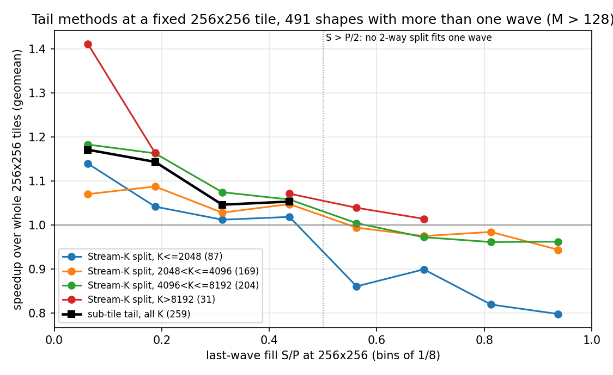
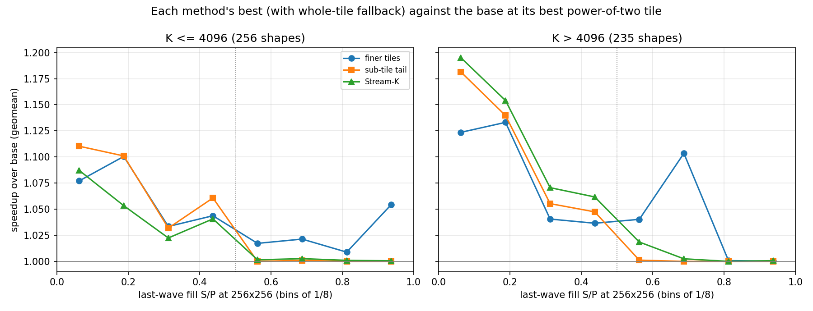
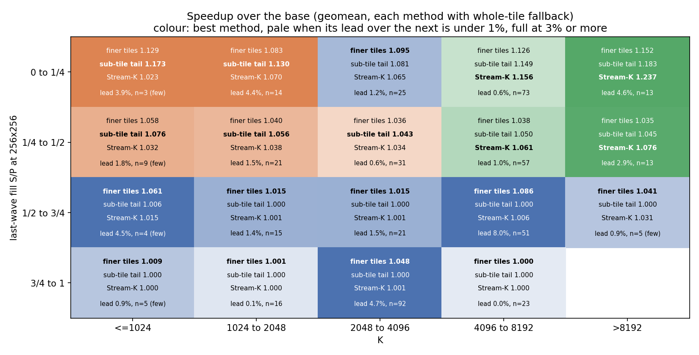
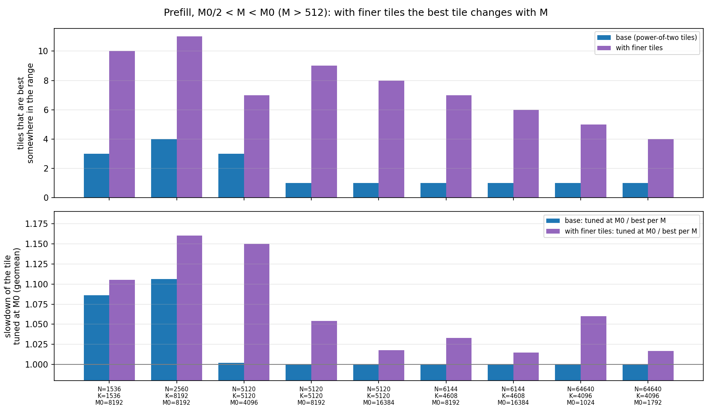
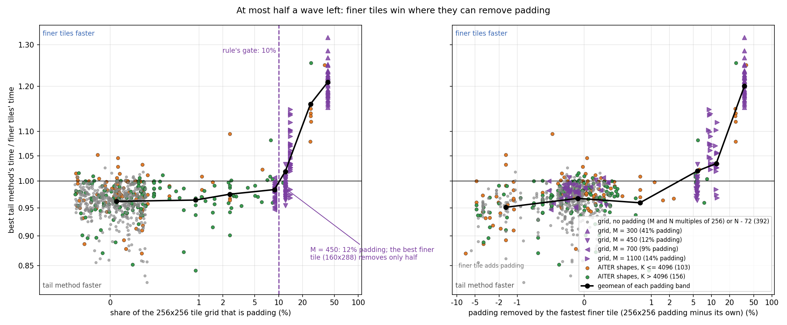
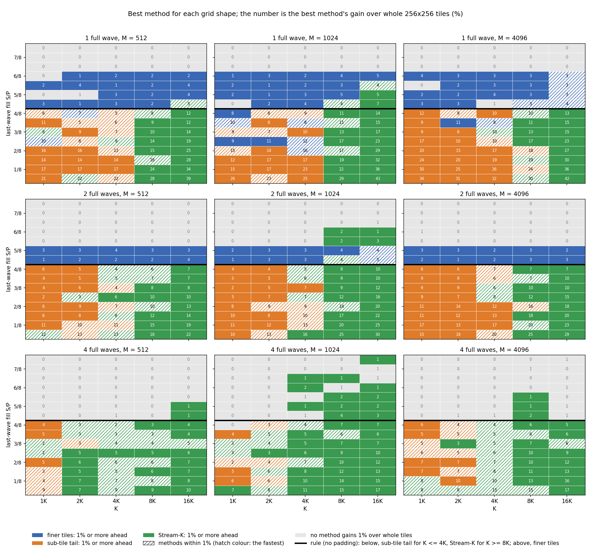

# Results

The experiments are done. The results are below; the problem, the terms and the three methods are as described in the ticket. Two more terms are used here:

- **Useful share**: M·N / (waves x P x tile area), the fraction of the tile slots that compute real outputs (it counts both the idle part of the last wave and the padding of ragged edges).
- **Whole tiles**: the base kernel with no tail method.

## The experiment

Four kernels, each tuned per shape with AITER's tuner. Each method's pick is chosen in the tuning run and then timed in a separate `--run_config` replay.

- **Base:** `gemm_a16w16.py`, the gfx950 gluon compute-bound kernel (PR [#5897](https://github.com/ROCm/aiter/pull/5897)), with power-of-two tiles (sides 64, 128 or 256).
- **Finer tiles:** `gemm_a16w16_uneven.py`, the base with uneven quadrant halves: sides any multiple of 32 from 64 to 320, at most 256x256 of accumulators.
- **Sub-tile tail:** `gemm_a16w16_subtile.py`, the base with each of the S leftover tiles cut into Q sub-tiles of sides 64, 128 or 256, subject to S·Q <= P (the same rule as gfx1250's).
- **Stream-K:** the splitting plans of `gemm_a16w16_streamk.py` (PR #7391). This is a persistent kernel: each CU runs one workgroup that loops over its tiles. Its data-parallel plan (persistent, no split) shows what the persistent loop alone is worth. At a 256x256 tile it is level with the base's whole tiles for K > 2048 (1.003 to 1.007), so there the differences shown below come from the split. At short K the persistent loop is faster: 1.061 for K <= 1024 and 1.019 for 1024 < K <= 2048, most likely because it overlaps each tile's fixed costs (filling the load pipeline, the epilogue) with the next tile. Stream-K's results at short K include this gain, which the other methods do not have (see Caveats).

The finer-tile and sub-tile kernels are small diffs to `gemm_a16w16.py`; their source is attached at the end of this issue. With the new feature switched off, both compile to exactly the base's machine code (all 9 power-of-two tiles, with and without bias, ragged M/N and ragged K), so every difference measured below comes from the tail method. Unless stated otherwise, each method may also fall back to the base's whole tiles, as a tuner would.

**Shapes.** All bf16 shapes in AITER's tuned configs (`aiter/configs/bf16_tuned_gemm.csv` and the 26 `model_configs/*bf16_tuned_gemm*.csv` files; bf16 input and output, tuned for 256 CUs) for which 256x256 tiles give more than one wave with a partial last wave. That is 552 shapes, of which the kernels support 550 (N and K multiples of 8, K >= 256). The 59 of these with M <= 128 are decode-like shapes on which the base never uses 256x256 tiles (it uses tiles such as 64x64), so their leftover at 256x256 is not the one the base sees; they are left out, which leaves 491 shapes. Two control sets of 30 shapes each, one with exactly full waves and one below one wave, give the expected ties.

**Baselines and tiles.** S, the last-wave fill S/P and the padding share are always counted at 256x256 tiles. They describe the shape on a fixed yardstick, whatever tile a method then runs. Except in section 1, which isolates the tail methods against whole 256x256 tiles, the baseline is the base at its best power-of-two tile for each shape: 256x256 on 459 of the 491 shapes, 128x256 or 128x128 on most of the rest. Every method is tuned over its own full menu (Stream-K over 9 tiles from 64x64 to 256x256, each with several plans; the sub-tile tail over main tiles from 128x64 to 256x256, each with its legal sub-tiles; finer tiles over 62 tiles) and may also fall back to the base's whole tiles. Stream-K's picks use 256x256 on 439 shapes and 128x256 or 256x128 on the rest.

This is not an exhaustive sweep. The shapes are the ones AITER ships configs for: they come from real models but are not spread evenly. K is concentrated between 2048 and 8192, and some groups are small (21 shapes with K <= 1024, 31 with K > 8192). The aim is to show where each approach helps and to motivate the follow-up work, not to rank the approaches on every possible shape.

**Reading the tables.** Each cell is the geomean speedup / share of shapes faster by more than 3% / share slower by more than 3%. "A vs B" is t_B / t_A, so above 1 means A is faster. Last-wave fill is grouped in quarters (0 to 1/4, 1/4 to 1/2, 1/2 to 3/4, 3/4 to 1). On 90% of shapes, a pick's replay time is within -2.2% and +3.3% of its tuning time.

## Results

### 1. The mechanism at a fixed 256x256 tile

This section isolates the two tail methods. Both run with the same main tile as the base, 256x256, so the only difference from whole 256x256 tiles is what happens to the S leftover tiles. All numbers come from the tuning profile, which times every candidate. Tables 1a and 1b compare against whole 256x256 tiles (the base kernel forced to 256x256); Table 1c then lets each method tune its main tile and compares against the base at its best tile.

Figure 1 plots each method against whole 256x256 tiles by last-wave fill, with Stream-K split into four K groups. Table 1a gives the same comparison in quarters of fill, over all K:

**Table 1a.** Against whole 256x256 tiles, by last-wave fill:

| Last-wave fill | Shapes | Stream-K | Sub-tile tail |
|---|---|---|---|
| 0 to 1/4 | 128 | 1.145 / 85% / 1% | 1.153 / 88% / 0% |
| 1/4 to 1/2 | 131 | 1.047 / 66% / 3% | 1.051 / 76% / 1% |
| 1/2 to 3/4 | 96 | **0.964** / 4% / 47% | not possible (S·Q > P) |
| 3/4 to 1 | 136 | **0.931** / 0% / 71% | not possible (S·Q > P) |

Both methods help most when the last wave is nearly empty. Neither helps with more than half a wave left: the sub-tile tail cannot be used (any split needs more than one wave), and Stream-K's split costs more than it recovers.

**Table 1b.** Against whole 256x256 tiles, by K:

| K | Stream-K, at most half a wave left | Sub-tile tail, at most half a wave left | Stream-K, more than half a wave left |
|---|---|---|---|
| K <= 1024 | **1.009** / 33% / 25% (12) | **1.150** / 92% / 0% (12) | 0.804 / 0% / 100% (9) |
| 1024 < K <= 2048 | 1.045 / 51% / 3% (35) | 1.088 / 80% / 0% (35) | 0.861 / 0% / 100% (31) |
| 2048 < K <= 4096 | 1.058 / 64% / 0% (56) | 1.069 / 68% / 2% (56) | 0.957 / 0% / 57% (113) |
| 4096 < K <= 8192 | 1.122 / 88% / 1% (130) | 1.111 / 87% / 0% (130) | 0.976 / 3% / 51% (74) |
| K > 8192 | **1.150** / 92% / 0% (26) | 1.108 / 85% / 0% (26) | 1.029 / 40% / 0% (5) |
| all | 1.094 / 76% / 2% (259) | 1.100 / 82% / 0% (259) | 0.945 / 2% / 61% (232) |

The number of shapes is in brackets.

- **Stream-K:** the split has a fixed cost. With at most half a wave left it breaks even at K <= 1024 and gains more as K grows, up to 15% for K > 8192. With more than half a wave left it loses, except at the longest K. At K <= 1024 its 1.009 includes the persistent loop's 6% (see The experiment), so the split alone is about 0.95 there.
- **Sub-tile tail:** it gains about the same at every K (1.07 to 1.15). Against Stream-K, it is ahead for K <= 4096, about level for 4096 < K <= 8192 (1.111 against 1.122), and behind for K > 8192.

**Table 1c.** Each method with a tuned main tile (no fallback to whole tiles), against the base at its best power-of-two tile, by K:

| K | Stream-K, at most half a wave left | Sub-tile tail, at most half a wave left | Stream-K, more than half a wave left | Sub-tile tail, more than half a wave left |
|---|---|---|---|---|
| K <= 1024 | 0.993 / 33% / 33% (12) | 1.105 / 92% / 0% (12) | 0.933 / 0% / 67% (9) | 0.893 / 0% / 89% (9) |
| 1024 < K <= 2048 | 1.043 / 54% / 3% (35) | 1.084 / 80% / 0% (35) | 0.886 / 0% / 100% (31) | 0.854 / 0% / 100% (31) |
| 2048 < K <= 4096 | 1.053 / 62% / 0% (56) | 1.061 / 66% / 4% (56) | 0.963 / 0% / 49% (113) | 0.673 / 0% / 100% (70) |
| 4096 < K <= 8192 | 1.117 / 88% / 1% (130) | 1.107 / 86% / 0% (130) | 0.976 / 4% / 51% (74) | 0.820 / 1% / 99% (67) |
| K > 8192 | 1.149 / 92% / 0% (26) | 1.108 / 85% / 0% (26) | 1.029 / 40% / 0% (5) | 0.838 / 0% / 100% (5) |
| all | 1.090 / 76% / 2% (259) | 1.094 / 81% / 1% (259) | 0.957 / 2% / 56% (232) | 0.769 / 1% / 99% (182) |

This is the fairer comparison, because the base's best tile is not always 256x256: it is 256x256 on 459 of the 491 shapes, and on the others a smaller power-of-two tile already fills the waves better.
- **At most half a wave left:** the conclusions of Table 1b hold. The tuned results are lower only for 2048 < K <= 4096, where the base often already uses a smaller tile.
- **More than half a wave left:** both methods lose to the base. The sub-tile tail loses badly (0.769), because a split that fits in one wave needs fewer leftover tiles, which forces a small main tile. On 50 of these shapes no main tile allows a split at all, which is why its counts are lower.

### 2. End to end

Each method with fallback to whole tiles, against the base at its best tile (replay times), by last-wave fill:

| Comparison | 0 to 1/4 (128) | 1/4 to 1/2 (131) | 1/2 to 3/4 (96) | 3/4 to 1 (136) | All (491) |
|---|---|---|---|---|---|
| finer tiles vs base | 1.118 / 80% / 0% | 1.039 / 52% / 0% | 1.055 / 55% / 0% | 1.033 / 32% / 0% | 1.061 / 54% / 0% |
| sub-tile tail vs base | 1.137 / 87% / 0% | 1.051 / 73% / 0% | 1.001 / 0% / 0% | 1.000 / 0% / 0% | 1.048 / 42% / 0% |
| Stream-K vs base | 1.133 / 81% / 0% | 1.050 / 69% / 0% | 1.006 / 6% / 0% | 1.001 / 0% / 0% | 1.048 / 41% / 0% |
| finer tiles vs sub-tile tail | 0.983 / 6% / 34% | 0.989 / 6% / 17% | **1.055** / 55% / 0% | 1.033 / 32% / 0% | 1.012 / 23% / 13% |
| finer tiles vs Stream-K | 0.987 / 16% / 35% | 0.989 / 8% / 32% | **1.050** / 47% / 0% | 1.032 / 32% / 0% | 1.012 / 25% / 18% |
| sub-tile tail vs Stream-K | 1.004 / 16% / 15% | 1.000 / 10% / 9% | 0.995 / 0% / 6% | 0.999 / 0% / 0% | 1.000 / 7% / 8% |

By K:

| Comparison | K <= 1024 (21) | 1024 < K <= 2048 (66) | 2048 < K <= 4096 (169) | 4096 < K <= 8192 (204) | K > 8192 (31) |
|---|---|---|---|---|---|
| finer tiles vs base | 1.056 / 57% / 0% | 1.034 / 36% / 0% | 1.049 / 46% / 0% | 1.076 / 64% / 0% | 1.084 / 74% / 0% |
| sub-tile tail vs base | 1.057 / 48% / 0% | 1.044 / 42% / 0% | 1.019 / 21% / 0% | 1.066 / 54% / 0% | 1.093 / 71% / 0% |
| Stream-K vs base | 1.020 / 29% / 0% | 1.027 / 32% / 0% | 1.016 / 20% / 0% | 1.073 / 56% / 0% | 1.133 / 87% / 0% |
| sub-tile tail vs Stream-K | **1.037** / 38% / 5% | 1.017 / 26% / 3% | 1.003 / 4% / 1% | 0.993 / 1% / 6% | **0.965** / 0% / 65% |
| finer tiles vs Stream-K | 1.036 / 48% / 14% | 1.007 / 21% / 14% | 1.032 / 36% / 3% | 1.003 / 17% / 24% | **0.957** / 3% / 68% |

Figure 3 gives every method's geomean speedup over the base in each fill and K group. The colour is the best method, and its strength is the lead over the next method: pale under 1%, full at 3% or more. The results fall into four regions:

- **More than half a wave left: finer tiles**, in every K group (0.0% to 8.0% ahead of the next method).
- **At most half a wave left, K <= 2048: the sub-tile tail,** 1.5% to 4.4% ahead of the next method.
- **At most half a wave left, 2048 < K <= 4096: finer tiles or the sub-tile tail.** Finer tiles lead by 1.2% with the last wave at most a quarter full; the sub-tile tail leads by 0.6% from a quarter to half full. Section 6 shows that this region is split by padding: without padding the sub-tile tail wins, and finer tiles win where they can remove it.
- **At most half a wave left, K > 4096: Stream-K,** by 0.6% to 4.6%.

The overall geomean hides these differences, because each region is only part of the 491 shapes. The table gives the speedup over the base of using one method everywhere, of a few dispatch rules, and of the best method for each shape:

| Rule | All (491) | At most half a wave left, K <= 2048 (47) | of which at most a quarter (17) | At most half a wave left, 2048 < K <= 4096 (56) | At most half a wave left, K > 4096 (156) | More than half a wave left (232) |
|---|---|---|---|---|---|---|
| finer tiles everywhere | 1.061 | 1.062 | 1.091 | 1.062 | 1.087 | 1.042 |
| sub-tile tail everywhere | 1.048 | 1.089 | 1.138 | 1.060 | 1.106 | 1.000 |
| Stream-K everywhere | 1.048 | 1.045 | 1.062 | 1.048 | 1.120 | 1.003 |
| finer tiles, Stream-K for K > 4096 with at most half a wave left | 1.071 | 1.062 | 1.091 | 1.062 | 1.120 | 1.042 |
| as above, sub-tile tail for K <= 2048 with at most half a wave left | **1.073** | 1.089 | 1.138 | 1.062 | 1.120 | 1.042 |
| best method for each shape | 1.078 | 1.098 | 1.140 | 1.082 | 1.126 | 1.043 |

Adding the sub-tile tail to finer tiles and Stream-K moves the overall geomean by only 0.2%, because it applies to 47 of the 491 shapes. On those shapes it is worth 2.6%, and 4.3% when the last wave is at most a quarter full. Extending it to K <= 4096 gains nothing here: for 2048 < K <= 4096 it is 0.2% behind finer tiles, a region that section 6 shows is split by padding. The overall geomean also depends on the mix of shapes in AITER's configs, which is not weighted by how much time each shape takes in a model, so the per-region numbers are the ones to use for a dispatch rule.

**Stream-K's split against its persistent loop.** Stream-K runs in a persistent kernel, so part of its gain at short K is the loop rather than the split (see The experiment). Comparing its splitting plans with the better of the base and its persistent no-split plan separates the two. With at most half a wave left:

| K | Persistent loop vs base | Split vs persistent loop |
|---|---|---|
| K <= 1024 | 1.060 | 0.972 |
| 1024 < K <= 2048 | 1.025 | 1.025 |
| 2048 < K <= 4096 | 1.008 | 1.039 |
| 4096 < K <= 8192 | 1.006 | 1.107 |
| K > 8192 | 1.005 | 1.148 |

For K > 4096 Stream-K's gain comes from the split: the loop is worth under 1% and no shape gains more than 3% from it. For K <= 1024 the loop provides all of the gain, and the split on its own is slower.

### 3. Why finer tiles lose when S is small

A finer tile has lower intensity, and that cost applies to every tile in the GEMM. The median intensity of the picks is 128 for the base and 119.5 for the finer tiles.

Example: 1024x16896x7168 has 264 tiles at 256x256, so 256 run in the first wave and 8 in the second, which is 97% idle. No tile of at most 256x256 fits the GEMM in one wave, so filling two waves needs tiles of about half the area:

| Tile | Tiles | Last wave | Useful share | Intensity | Time (us) |
|---|---|---|---|---|---|
| 256x256 | 264 | 8 | 0.52 | 128 | 266.2 |
| 256x224 | 304 | 48 | 0.59 | 119 | 247.1 |
| 256x192 | 352 | 96 | 0.69 | 110 | 226.2 |
| 256x160 (pick) | 424 | 168 | 0.82 | 98 | 213.6 |
| 128x288 | 472 | 216 | 0.92 | 89 | 224.1 |

The sub-tile tail (193.3 us) and Stream-K (181.8 us) are faster because they keep 256x256 for the first 256 tiles and change only the last 8, which are 3% of the work.

As the number of full waves grows, every method gains less, because the last wave is a smaller share of the run time. Finer tiles do not fall further behind the others as the waves increase:

| Full waves | Shapes | Finer tiles vs base | Sub-tile tail vs base | Stream-K vs base | Finer tiles vs Stream-K |
|---|---|---|---|---|---|
| 1 | 185 | 1.109 | 1.079 | 1.077 | 1.030 |
| 2 | 76 | 1.062 | 1.064 | 1.060 | 1.002 |
| 3-4 | 92 | 1.034 | 1.032 | 1.036 | 0.998 |
| 5-8 | 67 | 1.025 | 1.016 | 1.018 | 1.007 |
| > 8 | 71 | 1.004 | 1.004 | 1.006 | 0.998 |

### 4. Comparison with hipBLASLt

The three methods are compared with each other because they share one kernel. To check that they are not weak implementations, they are also compared with torch, which runs hipBLASLt's own kernel choice through `F.linear`, timed in the same session as the base. hipBLASLt is an optimized library that also uses non-power-of-two tiles. The table shows t_hipBLASLt / t_ours on the 491 shapes, so above 1 means ours is faster:

| Ours | All | hipBLASLt tile at most 256x256 (155) | hipBLASLt tile larger than 256x256 (336) |
|---|---|---|---|
| base (power-of-two tiles) | 0.977 / 40% / 38% | 1.008 / 50% / 31% | 0.963 / 35% / 42% |
| finer tiles | **1.036** / 54% / 14% | 1.066 / 68% / 6% | 1.022 / 47% / 18% |
| sub-tile tail | 1.024 / 56% / 19% | 1.040 / 60% / 15% | 1.016 / 54% / 21% |
| Stream-K | 1.024 / 57% / 21% | 1.038 / 61% / 16% | 1.017 / 55% / 23% |
| best of the three | **1.053** / 68% / 9% | 1.073 / 76% / 6% | 1.044 / 64% / 10% |

The base is within about 2% of hipBLASLt, and each method is 2-4% ahead of it. On the 155 shapes where hipBLASLt also stays within 256x256 (the same maximum tile as ours), finer tiles are 6.6% faster.

What hipBLASLt chooses:

- **It changes the tile.** On the 128 shapes where the last wave at 256x256 is at most a quarter full, its tile leaves the last wave at least three-quarters full on 117 of them (exactly full on 30). Almost all its tiles have a non-power-of-two side.
- **It can use larger tiles.** This build uses tiles larger than 256x256 of accumulators on 336 shapes (for example 256x320, 288x288, 224x384 and 448x192). For 1024x16896x7168 it picks 256x272: 252 tiles in one wave at intensity 132 (185.8 us), whereas our finer tiles have to shrink to 256x160 (two waves, intensity 98, 213.4 us).
- **Its Stream-K rarely runs.** Every kernel it picks is a Stream-K kernel (`SK5`), but the launch grid has one workgroup per tile on 416 shapes and a whole number of tiles per workgroup on 71. Only 4 have a fractional number of tiles per workgroup, which is when a split can run. Nothing about these shapes favours Stream-K: 3 have exactly half a wave left at 256x256 (S = 128: 4096x6144x6144, 4096x6144x18432 and 16384x6656x2560), where the default grid's 1.5 (or 6.5) tiles per workgroup happens to land exactly on 256 CUs (see below), and the fourth (512x201088x2880) has 1347 small tiles, 5.5 per workgroup.

So hipBLASLt takes the finer-tiles approach, with a larger maximum tile. By region (t_hipBLASLt / t_ours):

| Region | Shapes | Base | Finer tiles | Sub-tile tail | Stream-K |
|---|---|---|---|---|---|
| At most half a wave left, K <= 4096 | 103 | 0.986 | 1.047 | **1.058** | 1.032 |
| At most half a wave left, K > 4096 | 156 | 0.929 | 1.010 | 1.027 | **1.040** |
| More than half a wave left, K <= 4096 | 153 | 1.013 | **1.048** | 1.014 | 1.015 |
| More than half a wave left, K > 4096 | 79 | 0.993 | **1.050** | 0.993 | 0.999 |

**Why hipBLASLt changes the tile instead of using Stream-K.** The reason is how hipBLASLt chooses its kernel, not a measured advantage of larger tiles. At most 31 of the 491 shapes are in hipBLASLt's tuned tables for this layout (in the ROCm SDK wheel torch loads); for the rest, it ranks its kernels with origami's latency model (`shared/origami` in rocm-libraries). Two parts of origami decide the result:

- **The latency model counts whole waves.** The predicted time is the time of one wave multiplied by the number of waves, ceil(tiles / CUs), whenever the Stream-K grid has fewer workgroups than there are tiles (`compute_launch_parameters` in `gemm.cpp`). So a Stream-K kernel with 272 tiles is predicted to take two waves, the same as with no split, and the model never sees what the split saves.
- **The default Stream-K grid (`k_split_aware` in `streamk.cpp`) gives each workgroup 1, 1.5, 1.125, 1.2, 1.25 or 1.33 tiles,** and takes the first of these, in that order, that fits on the CUs. With slightly more tiles than CUs that is 1.5 tiles per workgroup, on two thirds of the CUs.

A small example, M = 1024, N = 17408, K = 7168 (272 tiles at 256x256, 16 past a full wave), with hipBLASLt's kernels timed by `hipblaslt-bench`:

| hipBLASLt kernel | Tiles | Grid | Origami's waves | Measured (us) |
|---|---|---|---|---|
| 256x256, default grid | 272 | 181 workgroups, 1.5 tiles each | 2 | 243.2 |
| 256x256, no split | 272 | 272 | 2 | 268.2 |
| 256x256, Stream-K over all 256 CUs (`TENSILE_STREAMK_FIXED_GRID=256`) | 272 | 256 workgroups, 1.0625 tiles each | (not chosen) | 200.7 |
| 272x256 | 256 | 256 | 1 | 189.3 |

The whole-wave count is confirmed with origami's own model (the `origami` Python module in the ROCm SDK wheel that torch loads, `compute_total_latency`) for M = 1024, K = 7168: 346,927 for one full wave of 256x256 at N = 16384; 693,855 at N = 17408 (272 tiles) both with Stream-K over all 256 CUs and with no split, exactly twice the full wave; and 360,805 for 272x256 (256 tiles, one wave).

Origami predicts one wave for 272x256 and two for any 256x256 kernel, so it picks 272x256 here and, more generally, any tile that fits the waves better. For shapes where no tile fits, it falls back to smaller tiles over more waves rather than to a split. hipBLASLt's choice is therefore not evidence that larger tiles beat Stream-K; whether its own Stream-K would win depends on the cost of its split, which this study does not measure in enough cases to say.

### 5. Caution: a tuned tile is only good for the M it was tuned at

Every pick above is tuned at its own M. AITER's tuned configs cover only some values of M; other values reuse a nearby row through `getPaddedM` (which rounds M up to the next fine granularity, then to the next power of two). A tile tuned at M0 therefore also runs for M0/2 < M < M0.

To measure the cost, we took 9 prefill shapes from AITER's shipped configs (M0 from 1024 to 16384, from rows where torch was the fastest backend) and timed every base and finer tile at every M with M0/2 < M < M0 and M > 512 (191 points, confirmed by a `--run_config` replay with 0.4% noise). We then compared the tile tuned at M0 with the best tile at each M:

| Tile menu | Tile tuned at M0 / best tile per M (geomean) | Worst | Points more than 5% slower | Distinct best tiles over the range |
|---|---|---|---|---|
| base (power-of-two) | 1.017 | 1.37 | 7% | 1-4 |
| finer tiles | 1.055 | 1.45 | 33% | 4-11 |

Figure 4 has one pair of bars per shape (N, K and the tuned M0), over M0/2 < M < M0.
- **Top panel:** how many tiles are the best tile at one or more M in that range. With power-of-two tiles it is 1 on 6 of the 9 shapes (256x256 throughout); with finer tiles it is 4 to 11.
- **Bottom panel:** what reusing the tile tuned at M0 costs, against the best tile from the same menu at each M (geomean over the range).

What the results show:
- **Power-of-two tiles change in coarse steps,** so reusing the tuned tile costs little. The cost is at most 0.2% on 7 of the 9 shapes, and matters only at small N (1.09 for N = 1536 and 1.11 for N = 2560), where there are few tile columns and the wave fill changes quickly with M.
- **With finer tiles the best tile changes on every shape.** Reusing the tuned tile costs 1.5% to 16% per shape, 5.5% on average and up to 45% at a single M. Even reused, the finer-tile menu is still slightly ahead of the base (the base's tuned tile is 1.070 of the best finer tile per M), but most of its gain depends on choosing the tile for the actual M.

Finer tiles therefore need a tile selection that follows M (a cost model of waves, padding and per-tile throughput, or many more tuned M values), rather than one tile tuned at a single M and reused. Caveat: 9 shapes, all from rows where torch was the fastest backend, and two of them with small N.

The two tail methods are less exposed to this, because they keep the main tile and their tail depends only on S, which the kernel can compute from the actual M at launch (as gfx1250's rule does).

### 6. A dispatch rule from a controlled grid of shapes

The AITER shapes show what each method gains on real shapes, but they are not a designed experiment: K, the number of full waves, the last-wave fill and M move together, some regions hold only a few shapes, and near-identical shapes dominate others (18 shapes with M from 450 to 512, N = 37888, K = 5120). A rule fitted to them would follow that mix. So the rule is derived on a controlled grid and then tested on the AITER shapes.

**Grid.** Every combination of K in {1024, 2048, 4096, 8192, 16384}, W in {1, 2, 4} full waves of 256x256, S in {0, 16, ..., 240} leftover tiles (S/P in sixteenths; 0 is the control) and M in {512, 1024, 4096}, with N chosen to give exactly W x 256 + S tiles: 720 shapes. Two ragged sets: N - 72 for M = 1024, W in {1, 2}, K in {2048, 8192} (64 shapes), and M in {300, 450, 700, 1100} (9% to 41% of the 256x256 tile rows are padding), K in {2048, 8192}, W in {1, 2}, S/P up to 1/2 (128 shapes). In the factorial grid every M and N is a multiple of 256, so there is no padding. N - 72 keeps N a multiple of 8 (as the kernels require) and the tile count unchanged, but leaves the last tile column partly empty: it tests ragged N edges at almost no padding (0.15% to 0.44%). The ragged-M set is the padding test; it was added because the first fit disagreed with the AITER shapes for 2048 < K <= 4096, and the disagreement turned out to be padding (below). The smallest sides are M = 512 (300 in the ragged-M set), N = 4096 and K = 1024. All factorial and ragged-N shapes are on the compute side of the roofline: at least 338 FLOP per byte of minimum traffic (median 758), against a ridge point of about 310 for MI355X's bf16 peak and 8 TB/s. The 32 ragged-M shapes with M = 300 are just below it (260 to 290), but their fastest method moves only 3.0 to 3.7 TB/s of minimum traffic, so they are borderline rather than memory-bound. Every candidate of every method was timed, as in the main run.

**Timing.** A purpose-built harness (`grid_bench.py`) times each candidate exactly as AITER's tuner does: the same inputs (`torch.randn`, seed 0), the same rotation of input copies (up to 101, enough to cover 32 GB, so no iteration finds its inputs in L2 or MALL), AITER's own `run_iters_rotate` and `get_trace_perf` (device time of every kernel in an iteration, IQR outliers dropped), and the same correctness check. It does the per-shape setup once instead of once per candidate: 6 to 29 seconds per shape on the calibration shapes, against about 33 for the tuner. Before use it was calibrated on 60 AITER shapes (from the original 550), stratified by fill and K, against AITER's own `--run_config` replays in the same session: for the same kernel on the same shape the harness reads 0.2% to 0.8% higher at the median for every method (finer tiles 0.7%, Stream-K 0.5%, so no bias between methods), and it picks the same winning method, or one within 1% of it, on 55 of the 60 shapes. The grid was then timed twice, in two different seeded random orders, so drift over the run cannot look like an effect of K or W: each method's best differs between the two passes by 0.6% at the median (5-95%: -1.5% to +2.2%).

The machine itself had drifted since the main run: re-replaying 45 of its picks through AITER's tuner gave times 2-3% slower for finer tiles and the base alike. All comparisons below are within one session.

**Padding decides between finer tiles and the tail methods.** A finer tile can choose a side that fits a ragged dimension; the tail methods keep 256x256 tiles and pay for the padding in every tile. On the AITER shapes with at most half a wave left (finer tiles over each tail method, above 1 means the tail method is faster):

| Padding share at 256x256 | K | Shapes | Sub-tile tail | Stream-K |
|---|---|---|---|---|
| none | <= 4096 | 60 | 1.026 | 0.999 |
| none | > 4096 | 88 | 1.020 | 1.037 |
| more than 10% | <= 4096 | 6 | 0.864 | 0.868 |
| more than 10% | > 4096 | 4 | 0.938 | 0.929 |

Only 10 AITER shapes with at most half a wave left have more than 10% padding (M from 192 to 454); finer tiles are 11% faster than the better tail method on them. The ragged-M grid, with 128 shapes, shows the same thing in a controlled way, with one exception. Finer tiles beat the best tail method by 21% at M = 300 (41% padding; two rows of 160 fit) and 5.7% at M = 1100 (14%; five rows of 224 fit), but lose by 1.3% at M = 450 (12%), where the best finer tile (160x288, three rows of 160) removes only half of the padding (it leaves 6%) and costs intensity. What matters is the padding a finer tile can remove; the padding share is a simple proxy for it.

Figure 6 plots, for every shape with at most half a wave left, the better tail method's time over finer tiles' time (above 1: finer tiles faster). On the left it is against the share of the 256x256 tile grid that is padding, the quantity the rule tests; on the right, against the padding the fastest finer tile actually removes (the 256x256 padding minus its own). Grey points are grid shapes with no padding to remove: the tail methods win (the black line is the geomean of each padding band). Finer tiles take over above about 10% padding on the left, but the separation is cleaner on the right: the M = 450 grid shapes (12% padding, downward triangles) sit below 1 on the left, past the gate; on the right they sit at about 6 points removed, where the band geomean is close to 1, because their finer tile removes only half of the padding.

**Fitting the rule.** For each candidate padding gate (finer tiles above it), the tail method and S/P threshold for each K were chosen to minimise the geomean loss against the best method for each shape, over every grid shape the gate lets through, and the whole rule was scored on all 912 grid shapes:

| Finer tiles when the padding share is above | Loss against the best per shape | Shapes more than 3% slower |
|---|---|---|
| no gate | 0.95% | 9.0% |
| 2% to 7.5% | 0.27% | 1.6% |
| **10%** | **0.19%** | **0.7%** |
| 15% to 30% | 0.34% | 2.9% |

Under the 10% gate, the fitted tail method is the sub-tile tail for K <= 4096 and Stream-K for K >= 8192, in every one of 200 bootstrap resamples of the shapes. The sub-tile tail's threshold is S/P = 1/2 in every resample. Stream-K's is 1/2 or higher (up to 15/16 at K = 16384 and with four full waves), but capping it at 1/2 costs 0.02% on the grid and gains 0.06% on the AITER shapes, so the recommended rule caps it. The same split holds when the fit is repeated for each W and each M separately, except with four full waves at K = 2048 and 4096, where Stream-K edges out the sub-tile tail.

**Recommended rule.** With S the leftover tiles at 256x256 and P = 256: use finer tiles, except when at most half a wave is left (S/P <= 1/2) and no more than 10% of the 256x256 tile grid is padding; then use the sub-tile tail for K <= 4096 and Stream-K for K > 4096.

Finer tiles are the default: on the AITER shapes they are used for all 232 with more than half a wave left, where neither tail method helps (1.042 against 1.003 for the better tail method), and for the 10 with at most half a wave left and more than 10% padding (1.220 against 1.098). The tail methods take over only where they are better: with at most half a wave left and little padding (249 shapes), the better tail method gives 1.105 against 1.072 for finer tiles. There, to fill the waves, finer tiles must shrink every tile (section 3), while the tail methods keep 256x256 for the full waves and change only the leftover.

Figure 5 shows the best method for every factorial grid shape, faceted by W and M, with the rule's threshold as a black line. Solid cells: one method is at least 1% ahead of the next. Hatched: the methods are within 1% of each other (the hatch colour is the fastest). Grey: no method gains 1% over whole tiles. The number in each cell is the best method's gain over whole 256x256 tiles in percent. Above half a wave, most cells are grey: once the last wave is at least three-quarters full there is little left to recover, and finer tiles win clearly only just above half a wave with one or two full waves.

**Results.** Each cell is the geomean speedup over the base / the share of shapes more than 3% slower than their best method:

| Rule | Grid, harness (912) | AITER shapes, main run's replays (491) | AITER shapes, confirmed in AITER's harness (491) | Grid shapes, confirmed in AITER's harness (135) |
|---|---|---|---|---|
| finer tiles everywhere | 1.051 / 29% | 1.061 / 23% | 1.063 / 22% | 1.056 / 54% |
| finer tiles; Stream-K for K > 4096, S/P <= 1/2 | 1.056 / 19% | 1.071 / 8% | 1.072 / 10% | 1.070 / 33% |
| rule of section 2 (+ sub-tile tail for K <= 2048) | 1.059 / 11% | 1.073 / 5% | 1.075 / 5% | 1.084 / 12% |
| **recommended rule** | **1.070 / 1%** | **1.075 / 2%** | **1.077 / 2%** | **1.089 / 1%** |
| best method per shape | 1.073 | 1.078 | 1.081 | 1.093 |

The confirmation columns are fresh `--run_config` replays through AITER's tuner, in one session, of each method's pick (the main run's picks for the AITER shapes, the grid's for 135 grid shapes spread over every K, W and M), so the rule's result there does not depend on the harness. On the AITER shapes the recommended rule gets 1.077 against 1.081 for the best method per shape; time-weighted it gets 1.037 against 1.043. Most of its gain over the section 2 rule comes from the padding gate (1.076 against 1.062 for 2048 < K <= 4096) and from using the sub-tile tail up to K = 4096 where there is no padding.

**Stream-K's split, separated from its persistent loop** (grid, at most half a wave left): the persistent loop alone is worth 3.7% at K = 1024 and under 1.5% for K >= 2048, while the split adds 1.6%, 2.9%, 8.2%, 11.2% and 15.6% for K = 1024 to 16384.

**Why: the MFMA efficiency of the main loop.** Thread traces (`rocprofv3 --att`, one CU) of each method's winning kernel on 1024x18432x8192 (288 tiles, 32 past a full wave):

| Kernel | MFMA issue efficiency in the main loop | Main loop's share of the kernel's instruction time |
|---|---|---|
| base, 256x256 | 93.0% | 97% |
| Stream-K, 256x256 | 95.3% | 73% (the rest is its partial tile and fix-up) |
| sub-tile tail, 256x256 main tile | 94.4% | 65% (the rest includes the sub-tile) |
| finer tiles, 256x160 | 80.4% | 94% |

The two tail methods run the base's main loop at the same efficiency and pay only on the leftover tiles; finer tiles pay their lower intensity (98 against 128) in every tile, which is why they lose with a small leftover and no padding to remove. Whole-kernel counters on 12 grid shapes (MFMA busy cycles over busy CU cycles; median) agree: base 256x256 0.89, Stream-K 0.82, finer tiles 0.79, sub-tile tail 0.71 (its whole-kernel figure includes the small sub-tiles of the last wave, and several of its picks use a smaller main tile).

## Conclusions

- **No single method wins, but a simple rule gets almost all of the per-shape best** (section 6). Confirmed through AITER's harness on the 491 AITER shapes it was not fitted on, it gives 1.077x over the base against 1.081x for the best method per shape, with 2% of shapes more than 3% slower than their best; the best single method (finer tiles) gives 1.063x. The rule:
  1. **Use finer tiles by default,** together with a tile selection that follows M. They are the only method that helps with more than half a wave left, and they win where they can remove a large padding (more than 10% of the 256x256 tile grid), which the tail methods pay in every tile.
  2. **Except with at most half a wave left and no more than 10% padding: the sub-tile tail for K <= 4096, Stream-K for K > 4096.** Both keep the 256x256 main loop at the base's MFMA efficiency (93-95% in the thread traces) and pay only on the leftover tiles, where finer tiles would have to shrink every tile. The sub-tile tail needs no reduction or workspace, and gfx1250's simple selection rule gets 99.3% of its tuned result. Stream-K's gain at long K comes from the split, not its persistent loop.

  **The cost of finer tiles.** Their main loop runs at lower MFMA efficiency (80% at 256x160), a cost they pay in every tile, so they win only when the leftover is large or there is padding to remove. A finer tile tuned at one M and reused over the other M values that share its config row loses 5.5% on average against the best tile at each M, and up to 45% (section 5); power-of-two tiles lose 1.7%.
- **hipBLASLt changes the tile rather than splitting because origami's model counts a Stream-K kernel as whole waves** (section 4), not because larger tiles were measured to be better. Whether larger tiles in our kernel would match Stream-K is not measured.
- **Next steps:**
  - implement the rule in the dispatcher (S, K and the padding share are all known at launch);
  - refine the padding test to "padding a finer tile can remove" (at M = 450, 12% padding, the best finer tile removes only half of it and the tail methods stay 1.3% ahead);
  - a tile selection for finer tiles that follows M (a cost model of waves, padding and per-tile throughput);
  - finer tiles larger than 256x256 of accumulators, as hipBLASLt uses, where LDS allows;
  - combining a finer tile with a tail method;
  - a persistent version of the base kernel for short K, which on its own gains about 4-6% for K <= 1024 and 1-2% for 1024 < K <= 2048, whatever is done with the leftover tiles.

## Caveats

- One workgroup per CU (P = 256). Picks are tuned per shape, so each method's result is an upper bound: a dispatch rule will get somewhat less, and finer tiles reused across M much less (section 5).
- Finer tiles here have sides of at most 320 and at most 256x256 of accumulators; the current hipBLASLt goes beyond that.
- Stream-K runs in a persistent kernel and the other methods do not. For K <= 2048 the persistent loop is worth 2-6% by itself, so the short-K comparison favours Stream-K; the sub-tile tail's lead there is, if anything, understated. "Stream-K" also means only its splitting plans: its data-parallel plan is not counted for it.
- A partly full wave runs at a higher clock (PR #7391, power appendix), so every method's gain shrinks as the last wave fills up.
- hipBLASLt is a different kernel, so the comparison with it shows that our variants are competitive, not which tile choice is better.
- The grid is bf16 without bias, at five values of K; an AITER shape takes the rule for its K group (K <= 1024, ..., K > 8192). Its M values are multiples of 256 apart from the ragged-M set, so the 10% padding gate rests mainly on 128 grid shapes and 10 padded AITER shapes.
- The grid was timed with a purpose-built harness, calibrated against AITER's tuner (section 6); the rule's headline numbers come from AITER's own replays.
- The thread traces cover one shape and one CU each; the counters cover 12 shapes.
- The AITER comparison leaves out the 59 decode-like shapes with M <= 128, where no method uses 256x256 tiles; including them changes the rule's result by under 0.5% (1.070 against 1.073 for the best method per shape, in the main run's replays).

## Attached

- `gemm_a16w16_uneven.py`: finer tiles (uneven quadrant halves), built on `gemm_a16w16.py`.
- `gemm_a16w16_subtile.py`: the sub-tile tail, built on `gemm_a16w16.py`.
